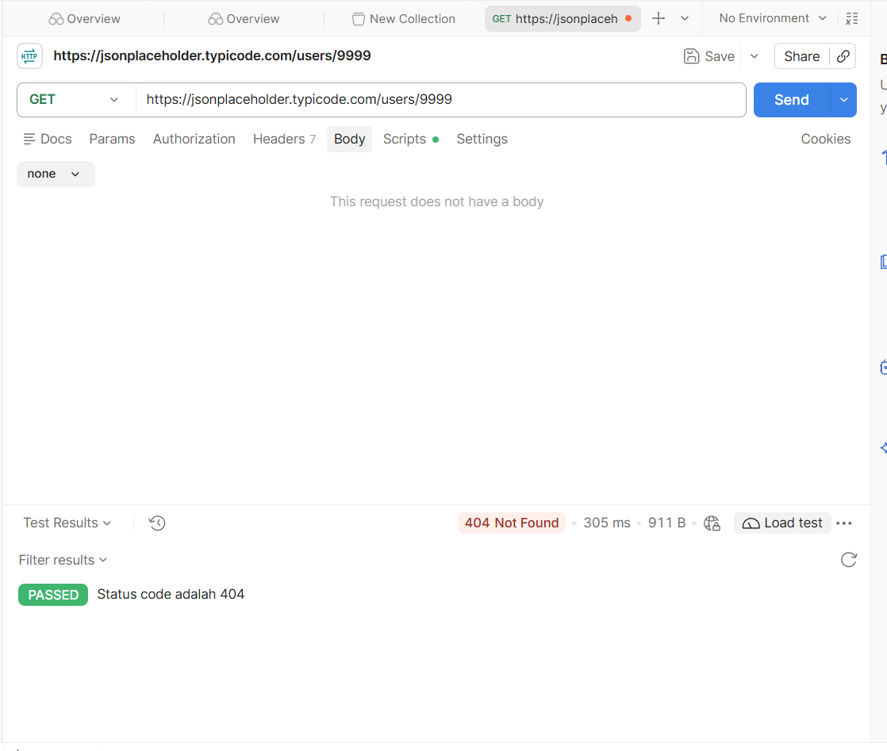
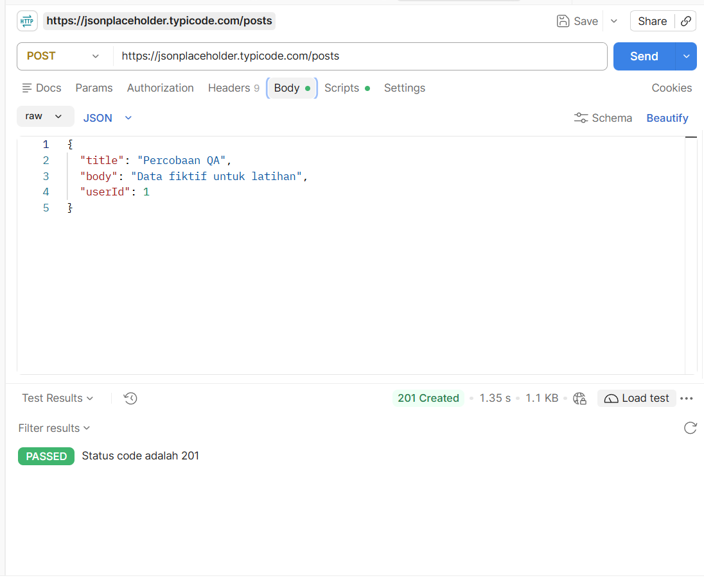

# Test Case API: Users (jsonplaceholder.typicode.com)

**Tools:** Postman
**Base URL:** https://jsonplaceholder.typicode.com

| Field | Isi |
|---|---|
| ID | TC-API-001 |
| Title | Request data pengguna dengan ID yang tidak ada mengembalikan 404 |
| Endpoint | GET https://jsonplaceholder.typicode.com/users/9999 |
| Precondition | Postman terbuka, koneksi internet aktif |
| Steps | 1. Buat request baru di Postman 2. Pilih method GET 3. Masukkan URL endpoint 4. Klik Send |
| Test Data | ID pengguna: 9999 (tidak ada di server) |
| Expected Result | server  membalas dengan status 404 Not Found dan body berisi "{}" |
| Actual Result | Status 404 Not Found, body `{}` |
| Status | Pass |

## Test Script (Postman, tab Scripts, After response)

```javascript
pm.test("Status code adalah 404", function () {
    pm.response.to.have.status(404);
});
```
## Evidence




| Field | Isi |
|---|---|
| ID | TC-API-002 |
| Title | POST data baru dengan data valid mengembalikan 201 Created |
| Endpoint | POST https://jsonplaceholder.typicode.com/posts |
| Precondition | Postman terbuka, koneksi internet aktif |
| Steps | 1. Buat request baru 2. Pilih method POST 3. Masukkan URL 4. Tab Body, pilih raw dan JSON, isi data 5. Klik Send |
| Test Data | {
  "title": "Percobaan QA",
  "body": "Data fiktif untuk latihan",
  "userId": 1
}|
| Expected Result | server  membalas dengan status 201 Created dan menghasilkan id baru:101 |
| Actual Result | Status 201 Created, body memuat data yang dikirim plus id: 101 |
| Status | Pass |

## Test Script (Postman, tab Scripts, After response)

```javascript
pm.test("Status code adalah 201", function () {
    pm.response.to.have.status(201);
});
```
## Evidence


